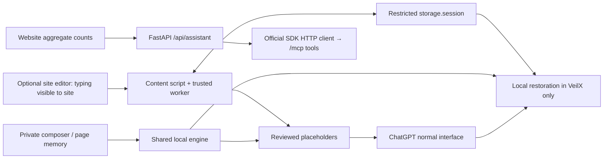

# VeilX — ARC.md

> Living architecture record. Implemented status only; detailed requirements remain in PRO.md.

## Current state
- **Phase:** Local hackathon MVP, 2026-10-23. Original offline architecture artifacts remain intact.
- **Implemented:** Shared local masking/restoration engine; light website and extension-owned composer; automatic protected-composer/site-editor veiling, review/manual marking, explicit protected send, manual reply fallback; aggregate-only FastAPI/MCP simulator; extension ZIP packaging.
- **Verification:** Engine, backend and loaded-extension fixture checks pass. Actual guest ChatGPT masks through its normal Send button and restores automatically in the panel. Final verification passes: 29 Node, 6 Python and 12 browser checks; core lines 100%, backend 87.59%. See `docs/mvp-verification.md` for exact evidence.

## Runtime boundaries

Raw originals and mappings never enter Python/MCP. Inline hints disclose that websites can observe typing in their own editors. Credentials never restore. Passwords, OTP, payment and authentication surfaces are excluded. No cookie access, history access, telemetry or cloud NLP.

## Modules
| Module | Actual path | Status |
| --- | --- | --- |
| Detection, mapping, restoration | `shared/privacy.mjs` | Local tests; exact tokens, precedence, Unicode, collisions, expiry |
| Tab/conversation scope | `shared/scope.mjs` | Tests include signed-in `/c/` and observed guest `/uc/` routes |
| Trusted session storage | `extension/background.mjs` | RAM-only restricted session storage; reset/navigation/closure/expiry |
| Protected composer | `ui/workspace.*`, `extension/panel.*` | Automatic local preview; manual review/restore; explicit send |
| Inline hints + ChatGPT adapter | `extension/content.mjs` | Loaded-extension fixtures and actual guest ChatGPT round trip verified |
| Website + scroll reveals | `web/`, `ui/styles.css` | Light responsive layout, reduced-motion and pause controls |
| FastAPI + MCP tools | `backend/app.py` | Real HTTP SDK transport; strict aggregate-only validation |
| Build + ZIP | `scripts/build-app.mjs`, `scripts/package-extension.py` | Bundled MV3 assets, compiled local CSS, downloadable ZIP |
| Regression tests | `tests/app/`, `tests/browser/`, `tests/*.test.cjs` | Core/backend/browser checks; historical 16 preserved |

## Decisions
- General Grammarly interaction patterns are recreated with original code; proprietary internals are not copied.
- HTML/vanilla JavaScript, locally compiled Tailwind, esbuild, compromise, Motion, FastAPI and official MCP SDK. No React or 3D runtime.
- Latest user preference: light ivory, white, teal and coral; flat background geometry and restrained scroll reveals, informed by 21st.dev references.
- Session mappings are local, tab/conversation bound and expire after 30 minutes of inactivity. Website mappings live only in page memory.
- Alexa+ is a labeled frontend simulation backed by a real MCP endpoint. No Amazon account linking, desktop companion, TinyFish, cookie access, database, OAuth or public hosting in this MVP.
- The private decision ledger is excluded from Git at the user's request.
