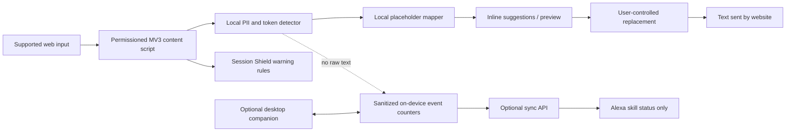

# VeilX — PRO.md

> **Implementation status, 2026-10-23:** The approved hackathon slice is implemented in `shared/`, `extension/`, `ui/`, `web/` and `backend/`. It includes automatic local veiling in the protected composer and, after activation, eligible site editors, manual review, explicit ChatGPT send, exact local restoration, and a real aggregate-only MCP simulator. Inline replacement and hints are a convenience that the provider can observe; originals are never restored into the provider page. Final verification is recorded in `docs/mvp-verification.md`. Broader requirements below remain the supplied product specification, not claims of completed functionality. Desktop, cookie access, TinyFish, OAuth, public hosting and Amazon account linking are deferred. The latest visual direction is light ivory/teal/coral with a flat background and accessible scroll reveals.

## 0. Mission and instruction to Codex

**VeilX — Your data stays yours.**

Build **VeilX**, a privacy-first security assistant that appears naturally wherever people type, *like the interaction model of Grammarly*, but instead of fixing grammar it identifies risky personal or session information **before the user shares it**. VeilX offers safe, consistent placeholders such as `[PERSON_1]`, `[ADDRESS_1]`, `[EMAIL_1]` and `[SESSION_TOKEN_1]`; it warns when content or user actions could expose sensitive data. It should feel like a lightweight, polished companion rather than a full-screen chatbot. Include an optional desktop companion and an Alexa+ voice skill connection without weakening privacy.

**The main product is data-leak prevention, not a generic cybersecurity news monitor or a grammar checker.** Do not substitute unrelated threat-intelligence features for the main product.

### Mandatory engineering workflow

1. Inspect the existing repository, its README, instructions (`AGENTS.md` where present), tests, dependencies, and unfinished work. **Work within the existing codebase; do not wipe or rebuild functioning modules without a reason.**
2. Locate and read the **reverse-engineering skill already installed in Codex**. Follow its documented workflow. Discover its actual name and path; do not invent them. If unavailable, document the limitation and perform a lawful public-UI behavior study.
3. Study the *observable user interaction* of Grammarly (user-supplied reference: https://www.grammarly.com/) and its public help docs: inline badge, near-caret indicators, underlined spans, compact suggestion popover, per-site toggle, accept/dismiss, and responsive feedback. Recreate these **general interface behaviors with original VeilX code and designs**. Do not copy branding, source code, assets, private APIs, protected data, or defeat anti-bot/authentication controls.
4. Before modifying code, map current files to the modules in `ARC.md`. Identify what's implemented vs. missing. Implement incrementally, run tests, and report proof (commands, screenshots where applicable, behavioral checks).
5. **Continuously maintain `ARC.md` as code changes**: keep it under about one page; note actual paths, implemented state, and decisions. Update after each substantial milestone/architecture decision and before concluding work. Never claim a feature works if only mocked.
6. Prioritize a functional and secure vertical slice over speculative integrations or UI polish. Do not silently add broad surveillance permissions, always-on keylogging or remote transmission of raw personal content.

---

## 1. Why this product exists

People paste real names, email addresses, phone numbers, postal addresses, identifiers, API keys and even session tokens into AI chats, support tickets, forms, and shared documents without realizing the consequences. A conventional writing assistant checks spelling **after text is entered**; VeilX checks for **privacy exposure before sharing**.

**Promise:** Help the user notice and replace sensitive information in supported editors and sharing flows, keep replacements coherent, and identify high-risk session/token leakage patterns. VeilX must never imply it can prevent every possible leak across the browser or operating system.

**Primary users:** Students, developers, professionals, content creators, support agents and privacy-conscious individuals.

**Demo story:** User enters:

> `Hi, I'm Maya Sharma. Email me at maya@example.com. I live at 18 Example Road, Delhi.`

VeilX highlights the personal fields and offers:

> `Hi, I'm [PERSON_1]. Email me at [EMAIL_1]. I live at [ADDRESS_1].`

The user can **Preview → Apply → Undo** without losing their cursor position or unrelated text. The original values remain on-device and are never shared with an AI provider or voice assistant. Examples above are fictional, and sample/demo data should never masquerade as a live detection.

---

## 2. Product surfaces

### A. Browser extension (MVP, highest priority)

- Chrome/Chromium **Manifest V3**, with `content_scripts` for user-authorized domains and isolated-world DOM interactions.
- Work first in ordinary `textarea`, text inputs that accept prose, and `contenteditable` editors. Expand to major apps only after successful compatibility tests.
- A subtle VeilX icon anchors near the active supported field, reminiscent of Grammarly's unobtrusive placement but with original design.
- Sensitive spans can be underlined/highlighted where editor APIs allow; otherwise display a contextual badge with a count and a nearby suggestion panel. Never overlay fake underlines misaligned to content.
- Compact popover shows **Detected / Why it matters / Replace / Ignore once / Trust site** and a preview of masked text, with no automatic raw-content upload.
- Per-site **Off / Suggest / Protect on send** toggle. Default **Suggest**; enabling Protect on send requires informed consent and testing for that site/editor. Avoid modifications to authentication or payment flows.
- Preserve caret/selection, focus, undo stack, IME composition and accessibility. Do not mutate unrelated DOM. Handle SPA navigation and dynamic fields. Account for iframes/shadow DOM limitations without overclaiming.
- Never activate on password fields, OTP inputs, payment-card entry forms, authentication pages or `autocomplete`/ARIA marked secrets; provide additional allow/block rules for sensitive websites.
- A **manual “Mask selected text”** action should work even where automatic field integration is unsupported, with explicit user control.

### B. Desktop app (after extension MVP)

- Native-feeling VeilX dashboard and quick panel on macOS initially, with extensibility to Windows.
- Lightweight approach preferred. Consider **Tauri + React/TypeScript** for a low-overhead tray/menu-bar companion; if the existing repository uses Electron, first evaluate whether to retain and optimize it instead of rewriting.
- Show privacy status, supported connected sites, masking activity counts (no content), detection preferences, approved integrations, and local vault controls.
- System-wide text selection assistance is **opt-in only**, implemented through supported OS accessibility or share/selection APIs with clear permissions. Do not implement a hidden keyboard logger, capture every keystroke, bypass sandbox restrictions, or promise to cover all third-party apps.
- When platform integration is unavailable, provide a clearly labeled paste-to-mask workspace as a supported fallback.

### C. Alexa+ connection (optional voice integration)

- Plan a VeilX **Alexa skill / supported Alexa+ integration** using Amazon's published developer mechanisms, where eligible; test against actual account/platform availability.
- Explicit opt-in **account linking** via OAuth 2.0 authorization code flow; validate requests, access tokens, scopes and signatures as appropriate. Never ask for the user's Amazon password.
- Suitable commands: “Alexa, ask VeilX for my privacy status,” “How many sensitive items did VeilX help mask today?” and “Turn on high protection for my connected device” (requires a device-side consent/approval flow and supported online connectivity).
- Only send **low-sensitivity aggregate metadata** (counts, protection state, last sync), not original detected text, placeholder maps, site-specific browsing history, cookies, passwords or tokens.
- Voice must not reveal addresses/names, read recent private content aloud, or remotely retrieve the local vault. Sensitive changes require authenticated device confirmation.
- If Alexa+ routing is not publicly available for the user's account or region, implement/test a compatible Alexa Skills Kit proof of concept and clearly identify the limitation instead of claiming native Alexa+ deployment.

---

## 3. Flagship feature — Placeholder Privacy Engine

### What to recognize

**Priority 1 (deterministic + opt-in custom values):** emails, phone numbers, full postal addresses where confidence is high, user-configured names, dates of birth in explicit contexts, government ID patterns (region-specific), and common secret/token formats (API keys, JWT-like content and copied session tokens).

**Priority 2 (model-assisted, locally if feasible):** names or addresses inferred from contextual prose, organisation-specific private identifiers, PII split across sentence boundaries. A false-positive confidence threshold and manual override are required.

**Never label ordinary names or dates as definitely private without contextual evidence.** Allow types and rules to be enabled/disabled.

### Placeholder system

| Input category | Example replacement |
| --- | --- |
| Person's full name | `[PERSON_1]` |
| Home or precise postal address | `[ADDRESS_1]` |
| Email | `[EMAIL_1]` |
| Phone | `[PHONE_1]` |
| Government identifier | `[ID_1]` |
| Birth date | `[DOB_1]` |
| Credential / API key | `[SECRET_1]` |
| Session cookie/token text typed into an editor | `[SESSION_TOKEN_1]` |

Rules:

- Use **stable placeholders for repeated identical values within a document/session**, preserving referential coherence. `[PERSON_1]` always refers to the same original within that scope.
- Keep the lookup mapping **local-only** and in memory by default; minimize its lifetime. A user-enabled persistent vault must use OS keychain-based key management / authenticated encryption; never `localStorage` for plaintext sensitive mappings.
- The stable mapping must not be guessable from the original (no raw hashes, no reversible encoding of personal information in placeholder labels).
- Handle overlap and precedence, e.g. email containing a name must not cause conflicting replacement spans. Process spans by position and priority; provide regression tests.
- Preserve punctuation and formatting. Provide side-by-side before/after preview with sensitive originals concealed unless deliberately revealed locally.
- Exclude code blocks or repositories only if user config says so; **still warn for credentials in code** without breaking syntax automatically.
- Protect the **outbound representation**: simply visually obscuring content is not enough. Users must see which exact text will be submitted. On supported editor integrations, validate the applied text before submit.
- Show a contextual warning for uncertain names/addresses; default to **Suggest**, not silent changes.
- Permit one-click undo and temporary reveal without network transfer.

### Example local data contracts (adjust to actual repository)

```ts
type SensitiveType =
  | 'person' | 'address' | 'email' | 'phone' | 'id'
  | 'dob' | 'secret' | 'session_token';

type Finding = {
  start: number;
  end: number;
  type: SensitiveType;
  confidence: number;
  reasonCode: string;
};

type MaskResult = {
  maskedText: string;
  findings: Array<Finding & { placeholder: string }>;
  // The reversible mapping is deliberately NOT included in API responses.
};
```

---

## 4. Session Shield — limit cookie and session leakage

**Goal:** Reduce **accidental exposure** of session credentials and suspicious browser destinations. Do not make an impossible claim that an extension can stop all cookie theft or inspect encrypted requests end to end.

### MVP features

1. **Token-in-text detection:** locally flag text resembling `Cookie:` headers, `Set-Cookie:` headers, session IDs, bearer tokens, long opaque auth strings, or JWTs when users paste them into supported text editors/chat prompts. Offer safe masking before submission.
2. **Clipboard/paste warning:** detect risky token-like material in a **user-initiated paste event on a supported field**. Do not continuously read the system clipboard or monitor unrelated apps.
3. **Unsafe destination warning / protection:** use privacy-preserving, scoped **Manifest V3 `declarativeNetRequest`** rules to block a conservative, clearly explained category of known-bad or user-blacklisted outbound destinations. DNR does not expose request bodies for arbitrary secret scanning.
4. **Session hygiene checks:** educational security checklist for cookie flags (`Secure`, `HttpOnly`, `SameSite`), suspicious pages, excessive extension permissions and shared sessions. Only claim automated checks when a supported API supplies the needed evidence and the user grants appropriate permissions.
5. **Site allowlist/denylist** and clear logs containing only event type, timestamp and sanitized site origin where allowed — never cookie values, authorization headers, raw URLs containing tokens, or session content.

### Deliberate security restrictions

- **Do not request `chrome.cookies` for the MVP.** Reading the cookie jar introduces new risk and is not required to detect token-like text pasted by the user. If an advanced consent-based cookie-*attribute* audit is later approved, separately justify permission and read/store only non-secret metadata; do not export cookie values.
- Never install a MITM certificate, inject request-body sniffers, scrape HttpOnly secrets, impersonate sessions, store/print auth headers, or send cookies to an external risk-scoring API.
- Do not claim to prevent server-side compromise, browser zero-days, all XSS, malicious extensions, or OS-level malware.
- Avoid alarmist false positives: “Possible session credential detected” is better than claiming a theft was blocked without evidence.
- If protection cannot be enforced in a particular context, show **not protected / unsupported** rather than a misleading green shield.

---

## 5. Design and interaction — Grammarly-inspired, VeilX-original

**Intent:** The user should forget the assistant is present until a meaningful privacy issue appears.

### Visual language
- Dark near-black `#08090D`, charcoal cards `#14161D`, near-white `#F5F5F7`, cool gray `#9297A5`, cyan-teal accent `#3CE7D2`, danger coral `#FF6475`.
- Match the provided VeilX logo style: shield/V ribbon icon, metallic blue/cyan accents, simple wordmark.
- Typography: Inter / Geist, clear accessible font sizes, ample spacing. Subtle glass/translucency only where it does not impair legibility.
- Smooth low-cost transitions (opacity/transform). Avoid persistent expensive blur and animations.
- Interactions must be keyboard-accessible and work with zoom, screen readers and reduced motion.

### Flow: privacy check while typing

```text
User focuses a supported input
 → tiny VeilX field badge appears
 → user types/pastes text
 → local detector flags specific spans
 → badge shows risk count + subtle underline/highlight
 → user opens compact suggestion popover
 → sees type, explanation, masked preview
 → chooses Mask all / Mask this / Ignore / Trust this domain
 → safe replacement applied with undo available
 → only masked text is submitted (on supported, verified editor flows)
```

### Dashboard / screens

- **Onboarding:** what is scanned, never-scanned fields, site permissions, default Suggest mode; enable protection only after clear consent.
- **Home:** Privacy status (enabled/paused), recent protection *counts*, active sites, “Test masking” interactive demo; labels distinguish sample vs real data.
- **Sites:** per-site opt-in permissions, protection level, incompatibilities; individual toggles and domain explanation.
- **Privacy Vault:** whether mappings exist in the current session, optional encrypted persistence, lock/clear (never display raw values by default).
- **Session Shield:** warnings, permitted rules, last risk event with no secret values, limitations and why certain checks are unavailable.
- **Connected Apps:** browser companion + Alexa+ link/unlink with explicit disclosure.
- **Settings:** detector sensitivity, enabled entity categories, auto-mask policy, export/reset non-sensitive preferences.

Design target: responsive dashboard for 1440px desktop and 390px mobile; extension popovers must be compact and avoid covering the caret or submit button.

---

## 6. Recommended architecture and technology

Adapt this to the existing repository instead of forcing an unnecessary rewrite.

| Concern | Preferred implementation | Privacy rule |
| --- | --- | --- |
| Browser extension | TypeScript, React (popup/settings), MV3 service worker and content scripts, Vite-based build | Minimal host grants; no broad `cookies` permission |
| Core detector | Pure TypeScript package with local deterministic patterns; optional local NER | No server-side raw PII processing by default |
| Placeholder mapper | Pure TS with session-scoped map; OS-keychain vault only if optional persistence | Never serialize maps into analytics/API payloads |
| Inline UI | Minimal DOM/shadow-root overlay, event/selection adapters | No arbitrary page scripts or HTML injection |
| Desktop | Tauri 2 + React/TS if starting fresh; consider existing Electron first | Permissions explicit; no background keylogging |
| API / optional cloud | FastAPI (Python), typed endpoints, narrowly scoped metadata | No full text, raw secrets or session cookies |
| Persistence | Local encrypted settings; PostgreSQL only if cloud features need it | Data minimization, opt-in retention and deletion |
| Alexa | Alexa Skills Kit / supported Alexa+ adapter + OAuth account linking | Aggregated/sanitized data only |
| Optional TinyFish | Separate opt-in agent for checking **public** security advisories or reputation data | Never submit originals, token values, private browsing or vault data |
| Testing | Vitest, Playwright extension E2E, API tests, platform-specific tests | Synthetic fixtures only |

### Logical flow



### Security and trust boundaries

- Website DOM is untrusted: text can be malicious, forged or changed after scanning. Escape all output; never interpolate findings into `innerHTML`.
- Cross-origin frames, closed shadow roots, canvas-based editors and native desktop apps can be unsupported; show status rather than silently fail.
- Back end and Alexa are outside the local privacy boundary. Only user-approved, low-sensitivity aggregates may cross it.
- Keep events scoped to active fields. No omniscient browser tracking or browsing-history extraction.
- Network calls to remote threat intel/TinyFish require user opt-in and **sanitized public context**. Do not include the live document or identifiers.
- Secure settings, CSP, extension message validation, origin checks, limited privileges, dependency scanning, and signed releases.

---

## 7. Reverse-engineering research scope for Codex

**Target:** https://www.grammarly.com/ (and public support pages).

Use the installed reverse-engineering skill to **observe UX patterns** only:

- Map badge trigger, placement and position while typing.
- Record underlines vs. popover behavior, suggestion dismissal, and user controls.
- Investigate contenteditable/textarea behavior on a self-owned local test page.
- Study accessibility, focus changes, keyboard shortcuts, overlays, loading feedback, and visual hierarchy.
- Compare UI states with VeilX-specific protection and risk language; create original assets/components.
- Create a short implementation comparison in the developer's working notes (not in `ARC.md`): `Reference behavior → VeilX implementation → test`.

Respect terms, robots/access controls and intellectual property. **No copying extension bundles, extracting proprietary endpoints, bypassing authentication, or decompiling private assets.** If an observed behavior is impossible to implement with available public browser APIs, explain the constraint and choose an equivalent safe UX.

---

## 8. Build order (vertical slices and acceptance criteria)

### Phase 0 — audit + setup
- [ ] Discover repository layout, running instructions and installed Codex reverse-engineering skill.
- [ ] Note real existing modules and missing dependencies in short `ARC.md`.
- [ ] Run existing builds/tests before edits; establish regressions.
- [ ] Create realistic synthetic examples and local test pages (basic input, textarea, contenteditable, SPA dynamic input).

### Phase 1 — MVP you can demo
- [ ] Chrome MV3 extension loads in browser; per-site permissions and pause control work.
- [ ] Local detectors recognize email, phone, configured name/address and test token patterns; user sees confidence-aware warnings.
- [ ] Per-document stable replacement generates `[PERSON_1]`, `[ADDRESS_1]`, etc.
- [ ] Inline badge and popover stay correctly positioned; replacements preserve cursor, undo and input events on supported elements.
- [ ] Manual mask, mask all, ignore, undo, site toggle all perform real actions.
- [ ] Block all scanning on passwords/OTP/secure fields; local content not sent to the server or logs.
- [ ] Demo shows **the actual submitted masked value** on self-controlled form fixtures.

### Phase 2 — Session Shield
- [ ] Paste a fabricated token into an eligible field; warn and offer `[SESSION_TOKEN_1]`.
- [ ] User-blacklisted URL destination is blocked by an opt-in DNR rule and correctly reported.
- [ ] UI explains where blocking is unsupported and never claims universal cookie theft prevention.
- [ ] Inspect Chrome manifest for unnecessary permissions; confirm there is no `cookies` permission for MVP.

### Phase 3 — desktop and app polish
- [ ] Working dashboard and site/device connection states, with authentic events and empty states.
- [ ] Tray/menu-bar or panel as supported; explicit selection-based assist/paste-to-mask fallback.
- [ ] Reasonable CPU/memory, no constant polling/keylogging, smooth UI with reduced-motion fallback.
- [ ] Explicit local data clear/delete options work.

### Phase 4 — Alexa+ and optional public-web intelligence
- [ ] Prototype account linking with supported Alexa developer APIs; link/unlink fully tested where access exists.
- [ ] Alexa returns **only aggregated privacy status**, never original names, addresses, tokens or maps.
- [ ] Voice changes to protections are authenticated and confirmed locally before applying.
- [ ] If TinyFish is required for a hackathon: one concrete, opt-in public-advisory workflow with strict input sanitization and evidence/citations. **Never use TinyFish as a route to transmit private text**.

### Phase 5 — hardening and handoff
- [ ] Test overlap/collisions, multilingual text, IME, emojis/Unicode offsets, copy/paste, multiline content, dynamic DOM, large editors and repeated text.
- [ ] Security regression tests: password exclusion, no raw content in network requests/logs, input escapes, dangerous DOM, permissions, storage leaks, scope isolation.
- [ ] Accessibility audit (keyboard, screen reader labels, contrast).
- [ ] Document actual coverage, unsupported sites, threats not blocked, reproducible tests and release steps.
- [ ] Update `ARC.md` with **implemented** modules and honest status, no sprawling change log.

### Definition of done for each feature

1. Functions on a real supported surface, **not just in a screenshot**.
2. Includes success, empty, loading/error (if applicable), and unsupported states.
3. Has tests demonstrating behavior and privacy boundaries.
4. Does not leak raw personal text, cookies, tokens, keys or mappings to integrations or telemetry.
5. `ARC.md` reflects what was actually shipped.

---

## 9. Copy and demo examples

**Hero:** “Your data stays yours.”

**Subheading:** “VeilX spots sensitive information as you type and helps replace it before you share.”

**Popover:** “Potential personal information found. Protect your identity with one click.”

**Token warning:** “Possible session credential detected. Sharing it may let someone access your account. Mask before sending.”

**Privacy status:** “Protected on 3 enabled sites” only if that count is based on actual enabled sites; otherwise use “Enable your first site.”

**Honest limitations:** “VeilX protects supported text fields and selected high-risk destinations. It cannot guarantee protection against every browser or account compromise.”

**Demo acceptance scenario:** On a test chat editor, paste fictional contact information and a synthetic token; inspect local warnings, apply replacements and submit; verify destination receives placeholders only; switch to a password field and verify no VeilX activation; open dashboard to see *sanitized counters*; optionally ask Alexa for aggregate privacy status after consenting.

---

## 10. Primary reference docs (re-verify during implementation)

- Grammarly browser interaction (behavior reference): https://support.grammarly.com/hc/en-us/articles/115000091592-How-does-Grammarly-s-browser-extension-work-
- Chrome MV3 permission model: https://developer.chrome.com/docs/extensions/mv3/declare_permissions
- Chrome privacy-preserving network rules: https://developer.chrome.com/docs/extensions/reference/api/declarativeNetRequest
- Chrome cookies API and consent implications: https://developer.chrome.com/docs/extensions/reference/api/cookies
- Alexa+ account linking implementation: https://www.developer.amazon.com/docs/alexaplus/account-linking/steps-to-implement-account-linking
- Alexa+ OAuth authorization-code configuration: https://developer.amazon.com/docs/alexaplus/account-linking/configure-authorization-code-grant

## Final instruction

**Ship VeilX as a real privacy assistant first.** Preserve the Grammarly-like inline experience, replace sensitive names/addresses with reliable placeholders, mitigate accidental session-credential exposure within browser capabilities, and make Alexa+ an explicitly permissioned convenience layer. Update `ARC.md` while implementing, and avoid any claim of universal security or integration support that testing does not substantiate.
